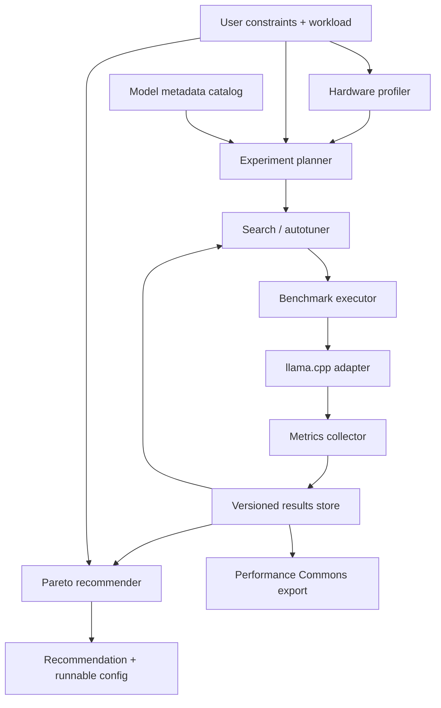

# Local AI Optimization Lab

## MVP and research proposal

**Status:** working proposal  
**Time budget:** 10–15 hours per week  
**Initial duration:** 16 weeks (~200 hours)  
**Initial backend:** llama.cpp  
**Primary workloads:** coding and general chat; long-context/RAG as a limited third profile if time permits.

## 1. Summary

Local AI Optimization Lab is an open-source experimentation and autotuning framework for local LLM inference.

Given a machine, a workload, and user constraints, it systematically measures viable local-inference configurations and recommends near-optimal ones. It treats the choice as more than “which model is fastest”: the user may need a model for **coding**, require a particular context length, have a RAM/VRAM budget, or prioritize interactive latency over batch throughput.

The MVP will initially drive **llama.cpp** rather than implement an inference runtime. Its output is both a useful recommendation and a reproducible dataset of benchmark results—the beginning of a future **Performance Commons**.

> **Core problem:** Given hardware **H**, workload **W**, constraints **C**, and available model/runtime/configurations, find a near-optimal local inference setup while running as few empirical benchmark experiments as possible.

## 2. Why this project

Projects such as [Magnitude](https://magnitude.dev/) demonstrate that hardware-aware local inference and tuning are valuable. They also make it unwise to build yet another standalone inference engine in a small MVP.

This project deliberately occupies a different role:

- It is **not** another model-serving platform or custom inference runtime.
- It is **not** a static benchmark table.
- It is a runtime-independent experimental system that measures, compares, and optimizes complete local-AI configurations.

Magnitude and other runtimes can eventually become systems that the framework measures. The project is not committed to making one runtime win.

This makes it useful in three ways at once:

| Goal | Value created |
| --- | --- |
| Research | Controlled comparison of search strategies and workload-aware recommendations. |
| Future cooperative | A technical methodology for assessing a client workload, sizing hardware, choosing models/runtimes, and tuning local deployments. |

## 3. Main MVP idea

The MVP is a command-line local inference laboratory with this end-to-end flow:

1. **Profile the machine**: CPU, memory, GPU/VRAM, OS, relevant backend capabilities, and runtime version.
2. **Describe the workload and constraints**: for example, `coding`, 16k context, interactive latency, and less than 8 GB VRAM.
3. **Plan experiments**: choose valid model/quantization/runtime-parameter combinations and avoid configurations that cannot fit.
4. **Execute benchmarks reproducibly**: invoke llama.cpp, warm up, repeat measurements, capture failures/OOMs, and retain provenance.
5. **Normalize results**: store prefill speed, decode speed, TTFT, latency, memory, and configuration details in a versioned local dataset.
6. **Tune and recommend**: use a small search strategy to find good configurations, then present Pareto-optimal alternatives rather than pretending there is one universal best configuration.

Example user interaction:

```text
$ ailab recommend --workload coding --min-context 16k --max-vram 8g --interactive

Recommended: Qwen Coder 7B Q4 on llama.cpp
  quality profile: coding
  context: 32k
  decode: 31 tok/s
  TTFT: 0.9 s
  VRAM: 6.7 GB

Alternatives:
  fastest: ...
  lowest-memory: ...
  balanced: ...
```

The tool may also generate the exact runtime invocation:

```text
$ ailab recommend --workload coding --run
```

## 4. Workload-aware optimization

Workload is a first-class input, not a label added after benchmarking. It changes what “good” means.

| Workload | Important dimensions |
| --- | --- |
| Coding | Code-generation quality, context capacity, interactive latency, decode speed. |
| General chat | General instruction-following quality, TTFT, conversational decode speed, memory. |
| Long-context/RAG | Context capacity, prompt-processing speed, peak memory, retrieval-compatible behavior. |
| Batch processing (future) | Sustained throughput, cost/power, concurrency, reliability. |

For MVP v0.1, quality will be represented by curated public quality metadata or a small transparent scorecard—not by attempting to build a giant evaluation suite. Benchmark runs measure the performance side of the decision; workload profiles determine the constraints and trade-offs used to rank candidates.

The system should expose alternatives on a Pareto front, for example:

- fastest viable configuration;
- lowest-memory viable configuration;
- balanced configuration;
- highest-quality configuration that still meets speed/latency constraints.

## 5. Scope and deliberate constraints

### Included in v0.1

- One runtime adapter: **llama.cpp**.
- One local machine for full validation.
- Around 5–10 candidate models/quantizations.
- Hardware/environment profiling.
- Reproducible benchmark protocol and normalized result schema.
- Automated runner with warmups, repetitions, timeouts, failed-run/OOM handling.
- Two workload profiles: `coding` and `chat`.
- A limited set of tunable parameters: threads, batch size, GPU layers/offload, context length, and selected cache/attention settings where supported.
- Grid/random search plus Pareto ranking.
- Local dataset export/import and validation.

### Explicitly deferred

- A custom inference engine or custom CUDA/Metal/Vulkan kernels.
- A full hosting/serving platform.
- Support for every runtime, model family, OS, or accelerator.
- Large-scale crowdsourced benchmarking.
- A sophisticated universal model-quality benchmark.
- Production multi-user deployment management.

These boundaries keep the MVP feasible and make its results easier to interpret.

## 6. Architecture



### Main modules

| Module | Responsibility |
| --- | --- |
| `hardware/` | Detect machine capabilities and create a normalized, privacy-conscious machine profile. |
| `runtimes/` | Runtime adapter interface; `llama_cpp/` is the first implementation. |
| `models/` | GGUF/model metadata, sources, quantizations, context limits, quality tags. |
| `workloads/` | Workload profiles, quality requirements, benchmark prompts, and objective definitions. |
| `experiments/` | Declarative experiment plans, parameter spaces, provenance, repetitions, warmups. |
| `benchmarks/` | Process execution, timeout/OOM handling, raw-log capture, metric extraction. |
| `metrics/` | Normalized metrics and aggregation/variance calculations. |
| `optimizer/` | Grid/random search first; later pruning and Bayesian approaches. |
| `recommender/` | Constraint filtering, scoring, Pareto-front computation, human-readable explanation. |
| `commons/` | Versioned local results, validation, import/export, and future multi-machine sharing. |
| `cli/` | Commands such as `profile`, `benchmark`, `tune`, `compare`, `recommend`, and `results export`. |

### Core data model

A result must preserve the complete experiment tuple:

```text
hardware × model × quantization × runtime/version × runtime configuration
× workload × prompt/output shape × protocol version → measured metrics
```

Important initial metrics:

- prompt processing / prefill tokens per second;
- decode / generation tokens per second;
- time to first token (TTFT);
- total latency;
- peak RAM and VRAM when measurable;
- success, failure, timeout, or out-of-memory outcome;
- variance across repetitions;
- full provenance: tool/runtime version, model revision, protocol version, and timestamp.

## 7. Autotuning approach

The first tuner can intentionally be simple. Its job is to prove the interfaces and generate a reliable baseline.

### v0.1

1. Start from a legal configuration space.
2. Filter obviously impossible candidates using memory and compatibility constraints.
3. Run a bounded grid or random search.
4. Measure each candidate under the chosen workload profile.
5. Return Pareto-optimal configurations, then apply user preferences for a recommendation.

### Progressive research path

```text
Grid search
  → random search
  → successive halving / early pruning
  → Bayesian optimization
  → Commons-informed priors
  → hardware-aware learned tuner
```

The long-term objective is not necessarily “the highest possible tokens/sec.” It is to reach a target fraction of the best-known configuration with minimal tuning cost.

## 8. Research directions

The engineering system makes several genuine empirical questions possible.

### RQ1 — Workload-aware recommendation accuracy

> How accurately can workload-aware measurements identify a suitable local inference configuration under user constraints?

Evaluate whether recommendations meet required context, memory, and latency constraints while selecting competitive model/configuration choices for coding and chat.

### RQ2 — Search efficiency

> How efficiently can a tuning strategy discover a near-optimal local inference configuration for a given hardware + workload pair?

Compare exhaustive search (where feasible), random search, grid search, pruning/successive halving, and later Bayesian optimization.

Useful outcomes:

- experiments required to reach 90% and 95% of the best-known performance;
- wall-clock tuning time;
- performance regret compared with the best known configuration;
- recommendation error;
- robustness across different models, quantizations, and workloads.

### RQ3 — Transferable performance knowledge (future)

> Can results from similar machines reduce the number of experiments needed to tune a new machine?

This is where the Performance Commons becomes scientifically and practically valuable: past results become priors that narrow the search on a new machine.

## 9. Performance Commons

The Commons is a product of the experimentation framework, not the entire MVP.

It will begin as a Git-friendly, versioned, validated export format containing normalized results and sufficient provenance to reproduce or reject comparisons. Initially it can contain results from one machine; the schema must support multiple machines without collecting personally identifying data.

Later, this can enable:

- shared benchmark contributions;
- comparable results across machines and runtimes;
- searchable hardware/model/configuration evidence;
- priors for faster autotuning;
- planning data for local-AI deployments.

## 10. 16-week roadmap

Assumes a 10–15 hour weekly budget. Weeks 1–2 are intentionally learning-led; each includes small hands-on experiments rather than passive study only.

| Week | Focus | Concrete deliverable |
| --- | --- | --- |
| 1 | Inference fundamentals I: decoder transformers, tokenization, embeddings, attention, MLP, RMSNorm, RoPE. | `docs/inference-fundamentals.md` and small experiments. |
| 2 | Fundamentals II: autoregressive decoding, sampling, KV cache, GQA, prefill/decode, quantization, GGUF, llama.cpp. | `docs/local-inference.md`; run and inspect several GGUF quants. |
| 3 | Landscape and MVP specification. Study existing runtimes/tuners and write explicit non-goals. | `MVP_SPEC.md`, competitor/positioning matrix, CLI sketch. |
| 4 | Benchmark protocol and schema v0.1. | Protocol, prompt shapes, metric definitions, result schema. |
| 5 | Hardware/environment profiler and runtime-adapter contract. | `profile` command producing normalized JSON. |
| 6 | Reproducible llama.cpp benchmark runner. | `benchmark` command with warmups, repeats, raw logs, timeouts, failure states. |
| 7 | Model metadata and experiment planner. | Local catalog and valid configuration generation. |
| 8 | Baseline dataset and variance analysis. | First structured benchmark matrix and short methodology note. |
| 9 | Workload profiles and quality metadata. | `coding` and `chat` profiles with transparent quality/constraint rules. |
| 10 | Recommendation engine v1. | Constraint filtering and rule/data-based ranking. |
| 11 | Pareto recommendations and UX. | `recommend` output: fastest, lowest-memory, balanced, quality-first. |
| 12 | Autotuner v0: bounded grid and random search. | `tune` command with result persistence. |
| 13 | Performance Commons format and validation. | Import/export, validator, duplicate/provenance checks. |
| 14 | Reproducible run integration. | Generate exact llama.cpp configuration; optional `recommend --run`. |
| 15 | Evaluation and research baseline. | Compare search methods against known optimum on manageable spaces. |
| 16 | Release preparation. | Tests, examples, documentation, architecture diagram, demo, v0.1 release. |

## 11. Validation plan

The project must validate both its software and its recommendations.

### Software validation

- Unit tests for parsing, schema validation, aggregation, filtering, and Pareto computation.
- Fixtures for llama.cpp output and failure/OOM cases.
- Integration tests using a tiny model or mocked runtime adapter.
- Protocol-version validation and deterministic experiment definitions.

### Experimental validation

- Repeat representative benchmarks and report variance.
- Separate warmup from measured runs.
- Record full configuration and runtime/model versions.
- On a manageable search space, obtain a best-known exhaustive result.
- Run each search strategy under the same budget and compare regret, time, and number of evaluations.
- Test whether workload-specific ranking avoids the misleading “fastest equals best” recommendation.

## 12. Near-future roadmap after v0.1

### v0.2 — More capable laboratory

- Add second and third runtime adapters.
- Add pruning/successive halving.
- Extend model and workload metadata.
- Improve RAM/VRAM/power observability.
- Support more machines and platforms.

### v0.3 — Algorithmically interesting autotuning

- Bayesian optimization or other sample-efficient search.
- Better constrained multi-objective optimization.
- Runtime/model-specific parameter spaces.
- Calibration and prediction-error reporting.

### v0.4 — Shared Performance Commons

- Contribution workflow and schema evolution.
- Hardware similarity model.
- Commons-informed search priors.
- Cross-machine reproducibility reports.

### Longer term — Cooperative infrastructure

- Workload assessment templates for organizations.
- Hardware-sizing mode: “given this workload and budget, what should we buy?”
- Deployment-tuning mode for existing client hardware.
- Capacity/concurrency planning for private local-AI services.
- Monitoring and support tooling.

Only after data shows a persistent runtime bottleneck should the project consider low-level inference-runtime research: kernels, SIMD, GPU compute, memory layout, quantization, or KV-cache optimization.

## 13. Definition of MVP success

The MVP is successful if it can, on one real machine:

1. produce a normalized hardware profile;
2. run a reproducible suite of llama.cpp experiments;
3. store validated results with adequate provenance;
4. tune at least a small configuration space for coding and chat;
5. return explainable Pareto recommendations under user constraints;
6. compare at least two search strategies against a best-known baseline; and
7. publish a clear open-source repository, initial dataset, and demonstration.

That is enough to be a sound experimental base for research, and the first technical building block of a future local-AI cooperative.
